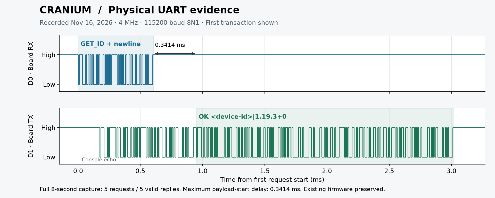

# CRANIUM — Chat-driven development with real hardware feedback

[](https://github.com/adamshal/cranium-closed-loop/actions/workflows/host-tests.yml)

**Our implemented workflow uses the ChatGPT/Codex chat agent to write code,
run tools, inspect measurements, fix problems and repeat the test.** On
November 16, 2026, we demonstrated automated UART testing of our existing
CRANIUM firmware using an **nRF7002 DK and a physical Saleae Logic 8**.
Five requests and five successful replies were independently recorded on the
wires. The agent ran the test and opened the resulting capture in Logic 2.

**Hapimatic did not orchestrate this demonstration. PPK2 power measurements
were not performed.** Those were part of an earlier proposed workbench and
remain optional infrastructure in this repository.

## Product and purpose

CRANIUM is our standalone DJ project: a Raspberry Pi runs the mixing interface,
a Pioneer DDJ-FLX4 provides physical controls, and a Nordic companion provides
a route for device/session information. Our broader chat-driven work included
touchscreen navigation, controller mappings, waveform zoom and effects.

This repository documents the **AI development workflow and Nordic hardware
test**, rather than containing the entire DJ application. The firmware already
on the team's board was preserved. The UART test queried its identity and
version; it did not send song history, test wireless delivery or flash a new
firmware image.

## How the loop actually worked

```text
Human defines the desired behavior and connects the hardware
                         |
                         v
ChatGPT/Codex agent edits the test code and runs the tools
                         |
                         v
Mac sends UART requests -> Nordic board replies
                         |
                         v
Saleae records the actual request and reply wires
                         |
                         v
Agent decodes the capture, diagnoses failures and revises the host tooling
                         |
                         +----------> Repeat the real hardware test
```

The human supplied the requirements, confirmed the wiring, and requested the
demo. The agent wrote the capture/validation code, selected the correct serial
interface, issued requests, interpreted physical captures, corrected its
implementation and reran the test. It was an interactive, agent-driven workflow
with human direction and physical setup—not an unattended all-day service.

### Concrete feedback and corrections

| Observation from the test | Change made from that evidence |
| --- | --- |
| An initial passive capture contained no transitions. | Recorded the idle result instead of calling it a pass; added a labelled UART stimulus. |
| The first J-Link serial interface produced no activity on the probed pins. | Tested the other interface and explicitly asserted DTR to enable the debug UART routing. |
| Labelled probe messages reached the board, which replied that they were unknown commands. | Read the existing console's HELP response and selected its supported, read-only GET_ID command. |
| The board returned `OK <device-id>|<version>` on one line, while the first checker expected a separate OK line. | Corrected the reply-format parser, then reran five real requests. An echoed command alone still does not pass. |
| Repeated GET_ID runs produced five complete replies on the analyzer. | Saved the real capture, decoded bytes, measured timing and result; opened the capture on screen. |

The demonstrated code-change/test loop concerned the **host test harness and
its integration with existing firmware**. We did not demonstrate autonomous
MCU firmware editing, flashing and retesting. This distinction matters when
assessing the scope of the lab submission.

## Measured result

Representative repeated run: **2026-11-16, 18:50:59 UTC**. These figures come
from that run's wire capture, not a simulation or a USB wall-clock timer.

| Measurement | Result |
| --- | --- |
| Board | nRF7002 DK, with its existing nRF5340-based CRANIUM firmware |
| Firmware version returned | 1.19.3+0 |
| Instrument | Physical Saleae Logic 8 |
| Capture | 8 seconds; digital channels 0 and 1 at 4 MHz |
| Serial format | 115200 baud, 8 data bits, no parity, 1 stop bit |
| Command | GET_ID, newline terminated |
| Requests decoded on D0 | **5 / 5**, 35 bytes total |
| Complete replies decoded on D1 | **5 / 5**, 160 bytes including console echoes |
| Reply payload-start delay, requests 1–5 | 0.3414, 0.3362, 0.3407, 0.3359, 0.3354 ms |
| Longest delay in this run | **0.3414 ms** |
| Read-only request/reply test | **PASS** |
| Firmware flashed or modified during this demo | **No** |

Timing is measured from the end of the command's UART frame to the start of
the valid response payload, excluding the console's echo. It is a measured
observation for this run, not a worst-case guarantee or a power result.
Other successful repetitions had slightly different timings.



### Evidence you can inspect

- [Measured run summary](evidence/logic-demo-2026-11-16/summary.json)
- [Original digital transition CSV](evidence/logic-demo-2026-11-16/digital.csv)
- [Decoded request/reply transcript](evidence/logic-demo-2026-11-16/transcript.txt)
- [Artifact hashes and provenance](evidence/logic-demo-2026-11-16/provenance.json)
- [Development record](DEVELOPMENT-LOG.md) and [validation scope](VALIDATION.md)

The CSV is the unmodified physical trace, which can be independently decoded.
It includes the project device identifier returned by GET_ID. Private USB
serial numbers, local access tokens, absolute host paths, firmware backups and
personal music files are not included in the public evidence. The original
local `.sal` capture's hash is retained in the provenance record.

The CI badge covers software tests and **offline replay of this saved trace**.
CI does not connect to a board or produce a new physical measurement.
The figure is generated from that CSV by `tools/plot-recorded-demo.py`
(optional dependency: Matplotlib); it displays the first transaction.

## Reproduce the demonstrated test

### Hardware

| Saleae lead | nRF7002 DK connection |
| --- | --- |
| D0 / channel 0 | **P0.22**, board UART RX: Mac → board |
| D1 / channel 1 | **P0.20**, board UART TX: board → Mac |
| GND | A pin labelled GND |

**P0.22 is an individual GPIO pin; it is not connector P22.** Leave the DK's
factory power jumpers in place. Disconnect the PPK2 and its measurement wires.
Connect the DK's debug/J-Link USB and the Saleae's USB to the Mac. No solder
bridge modification or PPK2 is needed for this UART test.

This test requires existing firmware that implements GET_ID with the observed
`OK <device-id>|<version>` reply. The separate experimental `app/` firmware in
this repository uses a different C1 protocol and is **not** the image tested
here. Do not replace the team's working firmware to reproduce this demo.

### Software and commands

1. Install Saleae Logic 2 from its official distribution and enable its
   Automation API on port **10430**.
2. Create a Python 3.12 environment and install the demo dependencies:

```sh
git clone https://github.com/adamshal/cranium-closed-loop.git
cd cranium-closed-loop
python3 -m venv .venv
.venv/bin/python -m pip install -r requirements-demo.txt
.venv/bin/python tools/configure-logic-demo.py
```

The configuration tool lists the connected J-Link serial interfaces and saves
an operator-selected port locally. **The demonstrated P0.22/P0.20 connection
used the second J-Link VCOM interface.** Port numbering varies, so verify it
from a capture rather than assuming the first listed port is correct.

Run the demo:

```sh
.venv/bin/python tools/logic-demo.py --seconds 8 \
  --uart-probe configured --read-only-demo --presentation --show
```

On the configured Mac, double-click **Run Logic Demo.command** for the same
visible test. It prints progress, captures the wires, checks all five replies
and loads the fresh capture in Logic 2. The `.sal`, raw CSV, decoded bytes and
JSON report are saved under ignored `captures/`; the latest report is referenced
by `.state/latest-logic-demo.json`.

A read-only test exits unsuccessfully if the five-request/reply check fails.
A passive capture without transmitting is also available:

```sh
.venv/bin/python tools/logic-demo.py --seconds 8 --show
```

The demonstrated path does not require Hapimatic, a Nordic SDK, a PPK2 or
flashing. Install the original `requirements.txt` and run `./bench test` to run
the broader host test suite, including the alternative C protocol tests.

## What is complete, and what remains

| Area | Status |
| --- | --- |
| Chat-driven agent code editing, debugging and tool execution | Used in this project and demo |
| Physical analyzer capture and automatic UART reply checking | Demonstrated, 5/5 |
| Evidence-driven correction and repeated hardware tests | Demonstrated for host tooling |
| On-screen demo in Terminal and Logic 2 | Demonstrated |
| Existing teammate firmware preserved | Yes |
| Autonomous firmware edit → flash → retest | Not demonstrated |
| Hapimatic-orchestrated agent session | Not used for the demonstrated workflow |
| PPK2 before/after measurements or power savings | Not measured |
| End-to-end Pi song-history → Nordic → laptop delivery in this test | Not tested |

## Repository layout and earlier work

```text
tools/logic-demo.py             actual capture runner and on-screen demo
workbench/logic_demo.py         reply verification from physical transition data
tools/configure-logic-demo.py   local instrument/serial selection
Run Logic Demo.command         visible Mac launcher
evidence/logic-demo-2026-11-16/ measured data, transcript, figure and provenance
tests/                         software checks and saved-trace replay
app/                           separate experimental Zephyr UART/BLE firmware
workbench/                     original build/flash/power/MCP infrastructure
GeneratedFiles/ppk2/            optional earlier power-measurement helper
prompts/                       agent instructions and original experiment prompts
```

The [professor's example](https://github.com/ese5180/hapimatic-test-v1) guided
our repository organization, reproducible source layout and emphasis on
measured evidence. Our demonstrated implementation uses the chat agent and
Saleae feedback described above. It does not copy that example's STM32 hardware,
accelerometer driver or power results.

The original Hapimatic/PPK2 proposal, Nordic build instructions and unexecuted
power-optimization acceptance test are retained in
[the legacy workbench documentation](docs/LEGACY-WORKBENCH.md). Its target of
25% lower power and its 100-frame C1/CRC/ACK test are **not results of this demo**.
Historical software-build evidence remains in
[evidence/software-validation.json](evidence/software-validation.json).

New CRANIUM code is MIT; SDK and tool dependencies retain their own licenses.
See [NOTICE.md](NOTICE.md) and [upstream.lock.json](upstream.lock.json).
